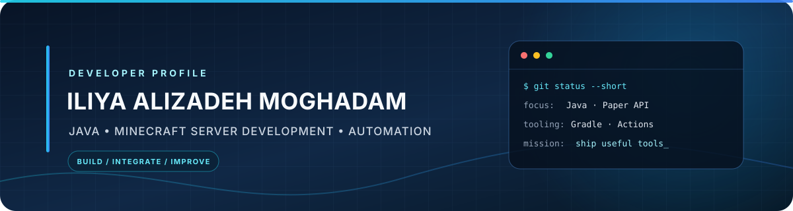

  

  
  
  
  
  

## About

Hi, I'm **Iliya**. I work mostly with Java and Minecraft server development, building plugins and small tools for Paper and Spigot servers.

I like keeping projects practical and readable. Most of my time goes into server-side features, integrations, debugging, and improving build or release workflows.

## Projects

### [Staffs-CMDLogger-Integration](https://github.com/BedlessFighterX/Staffs-CMDLogger-Integration)

A Bukkit plugin that sends selected staff command events to Discord. It supports command and player filters, argument redaction, optional console logging, and in-game configuration and diagnostics commands.

### [NecroManager](https://github.com/BedlessFighterX/NecroManager)

A Paper plugin for basic lobby and spawn management, including join and quit messages, configurable gameplay restrictions, and join effects. It is still an early-stage project.

## Tools I use

  
  
  
  
  

## GitHub

  
  

You can also see my [repositories](https://github.com/BedlessFighterX?tab=repositories) and contribution activity on my GitHub profile.

---

  Thanks for stopping by.

